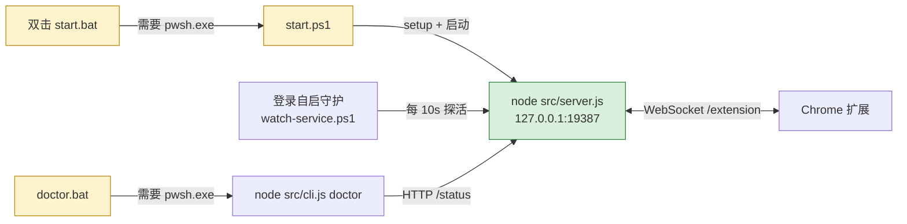

# 部署体验反馈：从「连接已断开」到长期自启

> **归档说明（2026-11-10，v0.37.3）**：本文是一份外部真实部署复盘，原文记录于 2026-11-09，观察对象是 `D:\Project\ai-browser-bridge`、报告版本 **0.5.22**；本仓库当时 `package.json` 为 **0.37.2**。项目内长期并行存在 `0.5.x`（功能叙述）与 `0.37.x`（工程版本）两套版本标记，**不能据版本号判断代码新旧**，本轮一律以源码逐字对账为准。原文 §9 引用的关联文档（`NOVICE-UX-REVIEW-2026-10-10.md`、`SERVICE-RECOVERY-EVIDENCE.md`、`DEPLOYMENT-2026-10-26.md` 等）在本仓库 `docs/` 下均存在，可确认是同一项目的另一处部署副本。**原文保留在下，未改动一字。**
>
> 本轮对本仓库逐条复核后确认：§3 的 8 条问题在 0.37.2 中全部或大部分成立，因此按 P0 → P2 逐项修复。额外发现两处原文未覆盖的事实：
>
> 1. `start.ps1` 与 `scripts/watch-service.ps1` 使用 `[Convert]::ToHexString`（.NET 5+ / PowerShell 7 才有），所以原文提到的 `README.md:162`「所有 `.ps1` 都不再要求 PowerShell 7，5.1 也能直接运行」在本仓库（`:229`）是**明确错误**。据此**不采纳**「.bat 回退 `powershell.exe` + 兼容封装」的方案 —— 那会把显式失败变成更隐蔽的运行时异常。改为「显式声明依赖 + 入口前置检测 + 失败可诊断」。
> 2. 本仓库 `doctor.bat` / `status.bat` 实际是 `pwsh → agent.ps1 → node src/cli.js` 多一层，但 pwsh 依赖不变，`doctor` 依然无法诊断「pwsh 缺失」。
>
> | 反馈条目 | 0.37.2 复核结论 | 0.37.3 处置 |
> |---|---|---|
> | P0-1 PowerShell 7 依赖未声明 / 未检测 | 成立：7 个 `.bat` 全硬编码 `pwsh.exe`；`:151` 只列 Node/Chrome，`:229` 与 `:186` 及 CHANGELOG 互相矛盾 | README 显式声明 + 离线 / 便携版安装路径；`scripts/check-runtime.bat` 前置检测 |
> | P0-2 双击入口静默失败 | 成立：5 个两行式入口无 `pause` / 日志 / 退出码；`install` / `uninstall` 成功也 `pause` | 7 个入口统一：失败落 `.local/launcher-error.log` + `pause` + 非零码，成功不阻塞 |
> | P1-3 `doctor` 只体检运行时 | 成立：`src/cli.js:133` 服务不可达时只给一句 `Run start.ps1` | 新增 `doctor-lite.bat` + `scripts/doctor-host-env.mjs`（零 pwsh 依赖，宿主检查项 + 可复制修复命令） |
> | P1-4 面板「从未连上」显示成「后台自动重连中」 | 成立：`extension/worker.js:1791` 短暂提示被 `:1802` 默认分支覆盖 | `hasEverConnected`（`chrome.storage.session` 持久化）+ 可操作文案，保留自动重连 |
> | P1-5 自启安装 / 卸载不闭环 | 成立：卸载清理的 `.vbs` / `.cmd` / `node-path.txt` 三项当前安装器根本不生成 | `.local/autostart-registry.json` 清单 + 逐项「已移除 / 未找到」+ `-StatusOnly` |
> | P2-6 运行时路径依赖会话 PATH | 成立：`Get-Command` 在不同启动路径会选中不同二进制 | `.local/runtime.json` + `scripts/resolve-runtime.ps1` 三入口共用 |
> | P2-7 代理与网络 | 部分成立：两处 `Invoke-RestMethod` 无 `-NoProxy`；winget / GitHub 限速属环境问题 | 本机探活显式 `-NoProxy`；`start.ps1` 区分「端口有监听但 HTTP 不通」与「端口无监听」；文档补离线安装 |
> | P2-8 缺重启验收清单 | 成立 | README 补「现象 → 命令」对照与重启后验收清单 |
>
> **本轮未采纳 / 延后**：官方计划任务式无人值守自启（原文 §5 P2）。本轮只**检测并如实报告**外部注册的任务，`uninstall-autostart.ps1` **不擅自删除**用户自己注册的任务；若以后官方纳入，安装与卸载必须同步覆盖。原文 §7 中「额外注册 `AI Browser Bridge Watchdog` 计划任务」是该部署环境的规避措施，不是项目自带能力。

> **反馈对象**：ai-browser-bridge 维护者
> **记录时间**：2026-11-09（GMT+8）
> **源码版本**：0.5.22（`package.json`、`extension/manifest.json`、运行中的服务三者一致，`doctor` 已校验 `buildId`）
> **性质**：一次真实 Windows 部署的完整复盘。所有结论都附命令输出或源码位置，未修改任何项目源码；本次为让服务常驻而新增的系统配置在文中单独标注。
> **关联文档**：[小白用户找茬评审](NOVICE-UX-REVIEW-2026-10-10.md) · [阻塞与不便清单](ai-browser-bridge-阻塞与不便清单.md) · [进程生命周期](PROCESS-LIFECYCLE.md) · [服务恢复证据](SERVICE-RECOVERY-EVIDENCE.md) · [0.5.22 部署验收](DEPLOYMENT-2026-10-26.md)

---

## 0. 结论摘要

**核心链路本身相当扎实**：这次从「服务没起来」到「扩展自动连回」只用了不到 20 秒；服务被强杀后，守护在 20 秒内重新拉起，`connected` 回到 `true`；从头到尾**没有重新配对**，`loadConfig(true)` 不轮换密钥这个设计经受住了多次重启的考验；`doctor` 用 `buildId` 而不是只看版本号来判定代码一致性，这个细节比很多同类项目严谨。

**但部署入口有一个结构性缺口**：所有双击入口都硬编码 `pwsh.exe`，而安装章节只声明「Node.js 22+、Chrome 120+」，`README.md:162` 甚至写着「所有 `.ps1` 都不再要求 PowerShell 7，Windows PowerShell 5.1 也能直接运行」。在未安装 PowerShell 7 的机器上，第 1 步 `start.bat` 就会失败，而且是**静默失败**：`start.bat` 没有 `pause`、不落日志、不传播退出码，双击后窗口一闪而过。用户唯一能看到的线索是扩展面板那句「连接已断开，后台自动重连中」——它既不说明服务从未启动，也不给任何可操作的下一步。

本次排障约八成时间花在「定位到 `pwsh.exe` 缺失」，而不是修桥本身。一句话概括：

> **运行时健康检查做得很细，宿主环境检查几乎为零；断线后的自愈很强，首次安装的自助性很弱。**

另一个值得注意的连锁问题：`doctor` 自身由 `pwsh.exe` 启动，因此它**天然无法覆盖「pwsh 缺失」这个最高频故障**——这正是「诊断工具与故障不在同一层」的经典盲区。

---

## 1. 环境与范围

| 项 | 值 |
|---|---|
| OS | Windows（Windows PowerShell 5.1.28000.1251，**初始无 PowerShell 7**） |
| Node | 机器级 `D:\Program Files\nodejs\node.exe` v22.22.2；另有 AI 工具链会话注入的 `C:\Users\love\.workbuddy\binaries\node\versions\22.22.2-6\node.exe`（不持久） |
| 浏览器 | Chrome，扩展以「加载已解压的扩展程序」方式载入 `extension/`，版本 0.5.22 |
| 桥接 | `127.0.0.1:19387`，配对密钥已保存在扩展中，允许所有 HTTP/HTTPS 网站 |
| 代理 | 会话级 `HTTP_PROXY` / `http_proxy` 大小写重复，同为 `127.0.0.1:9778`；`NO_PROXY` 为空；用户级与机器级环境变量中均无代理设置 |
| 目标 | 从「面板断线」恢复为「长期可用、重启电脑后仍自动生效」 |



黄色节点是本次全部故障的集中区：三个用户入口都依赖同一个未被声明、未被检测的宿主依赖。绿色节点（服务与扩展）反而是最稳的一环。

---

## 2. 现场时间线（真实操作与观察）

| 阶段 | 观察到的现象 | 关键命令 / 证据 | 结论 |
|---|---|---|---|
| 初始 | 面板显示「连接已断开，后台自动重连中 / 尚无操作」，密钥已配对、端口 19387 | `panel.html:9`；`worker.js:711` | 服务端不可达，非密钥不匹配（4002）、非第二配置占用（4003） |
| 服务层 | 端口无监听 | `Get-NetTCPConnection -LocalPort 19387` → 无；`npm run status` → `service-down`；`doctor` → `config ok` / `service-status false` | 服务根本没启动 |
| 入口层 | 所有 `.bat` 都调用 `pwsh.exe`，本机找不到 | `where.exe pwsh` 为空；`README.md:84` 只列 Node 22+ / Chrome 120+；`CHANGELOG.md:86`「所有双击入口使用 pwsh.exe」；`docs/HANDOFF.md:50`「所有 Windows shell 使用 PowerShell 7」 | **根因**：文档与实现不一致 |
| 自启层 | 启动文件夹只有 `desktop.ini`，`.local/watchdog-status.json` 不存在 | `install-autostart.ps1` 从未成功执行过 | 重启后不会自动恢复 |
| 运行时安装 | winget 的 PowerShell 7 是 MSIX 包，`StagePackageAsync` 阶段中断 | winget 日志 `WinGet-2026-11-09-19-16-52.905.log:32-34` | 改用官方 ZIP 便携版（8 段 Range 并行下载，单连接实测约 50 KB/s，240 秒仅 11.7 MB） |
| PATH 层 | 会话内启动的进程随工具会话结束被回收 | 首次直接启动 node 服务，日志出现 `listening on 127.0.0.1:19387`，下一会话进程已消失 | 必须交给任务计划程序托管 |
| 最终 | `connected: true`，`doctor ok: true` 全项通过 | 见 §7 | 已恢复并长期生效 |

---

## 3. 问题清单

### P0-1 · 前置依赖「PowerShell 7」在文档与入口之间不一致，且完全没有检测

**现象**：`README.md:84` 的安装要求是「Node.js 22+、Chrome 120+」，并强调「**不需要会命令行**：每个 `.ps1` 都配了同名 `.bat`，双击即可运行」。但 7 个根目录 `.bat`（`start` / `status` / `pair` / `stop` / `doctor` / `install-autostart` / `uninstall-autostart`）全部是 `pwsh.exe -NoProfile -File ...`；`install-autostart.ps1:5`、`stop.ps1:4`、`scripts/watch-service.ps1:7`、`scripts/upgrade.ps1:13` 也都 `Get-Command pwsh.exe -ErrorAction Stop`。

更矛盾的是三处说明彼此打架：

| 位置 | 说法 |
|---|---|
| `README.md:84` | 只要求 Node.js 22+、Chrome 120+，不提 PowerShell 7 |
| `README.md:162` | 「所有 `.ps1` 都不再要求 PowerShell 7，Windows PowerShell 5.1 也能直接运行」 |
| `CHANGELOG.md:86` / `docs/HANDOFF.md:50` | 「所有双击入口使用 pwsh.exe」/「所有 Windows shell 使用 PowerShell 7」 |

`.ps1` 或许确实兼容 5.1，但**用户实际双击的是 `.bat`**，而 `.bat` 只认 `pwsh.exe`。这条 README 注脚会让排查者误判「不需要装 PowerShell 7」。

**影响**：新机器/重装系统后，第一步就失败，且失败原因对用户不可见；已有 `docs/NOVICE-UX-REVIEW-2026-10-10.md` 的 P0-1 曾指出「README 要求 PowerShell 7 却不解释」，改成双击路线后，依赖没消失，只是被隐藏了——属于「修一个问题引入另一个」的回归。

**建议**：
1. 在 `README.md:84` 的前置要求中显式列出 **PowerShell 7（`pwsh.exe`）**，并给出安装与便携版两种路径；
2. 统一 `README.md:162` 的表述，明确区分「`.ps1` 脚本引擎兼容性」与「`.bat` 启动器依赖」；
3. 在每个 `.bat` 开头做前置检测（见 §6.1），缺依赖时给出中文指引与非零退出码；
4. 或者更彻底：让 `.bat` 优先 `pwsh.exe`、回退 `powershell.exe`，并对 PS7-only API（`[Convert]::ToHexString`、`ProcessStartInfo.ArgumentList` 等）做兼容封装。

### P0-2 · 双击入口失败静默：无 `pause`、无日志、无退出码传播

**现象**：只有 `install-autostart.bat` 和 `uninstall-autostart.bat` 带 `pause` + `exit /b %BRIDGE_EXIT%`；`start.bat`、`status.bat`、`doctor.bat`、`pair.bat`、`stop.bat` 都只有两行。当 `pwsh.exe` 不存在时，cmd 打印「'pwsh.exe' 不是内部或外部命令」后窗口立即关闭；用户看不到，也没留下任何文件。

**影响**：这是本次排查耗时最长的一环——没有任何本地证据指向入口层，只能靠逐层反推。`docs/SERVICE-RECOVERY-EVIDENCE.md` 已经把服务日志归档做得很细，但**入口层的失败连一行日志都没有**，证据链在最前端就断了。

**建议**：所有 `.bat` 统一：前置检查 → 失败写 `.local/launcher-error.log`（含时间、脚本名、退出码）→ `pause` → `exit /b` 非零码；成功路径不 `pause`（避免自动化被卡住）。可参考 §6.1 的公共头。

### P1-3 · `doctor` 只体检「运行时」，不体检「宿主」

**现象**：`src/cli.js:15-67` 的 `doctor()` 检查 `config`、`buildId`、版本一致性、`service-status`、`extension-connected`、`queue-idle`、`upload-roots`、`agent-policy`、`tools-schema`——全部是**服务起来之后**的状态。服务不可达时（`src/cli.js:51-55`），它只给一句 `Run start.ps1 and wait for status.`，不检查 `pwsh.exe` 是否存在、Node 版本、`PATH`、自启是否注册、端口是否被别的进程占用、代理变量是否吞掉 `127.0.0.1`。

更关键的是：`doctor.bat` 本身要 `pwsh.exe` 才能运行。**最高频的故障恰好让唯一的诊断工具无法启动。**

**影响**：用户按 `README.md:151`「先双击 `doctor.bat`，它会直接告诉你卡在哪一层」操作，得到的是「窗口闪一下什么都没有」，排查指引在最需要它的场景下失效。

**建议**：
1. 增加一个**不依赖 pwsh** 的诊断入口，例如 `doctor-lite.bat` 直接调用 `node src/cli.js doctor --host-env`；
2. `doctor` 增加 `host-env` 检查组：`pwsh.exe`/`node.exe` 的实际解析路径与版本、`.local/runtime.json` 与 PATH 是否一致、自启注册项（启动文件夹 / HKCU Run / 计划任务）、19387 监听者 PID、`NO_PROXY` 是否覆盖本机；
3. 每条失败项都带**可直接复制的修复命令**，而不只是 `Run start.ps1`；
4. 检查项要能区分「服务未安装 / 服务未启动 / 服务崩溃 / 端口被占用」四种状态（现有 `/status` 只有 `connected` 布尔值）。

### P1-4 · 扩展面板把「服务从未启动」显示成通用断连文案

**现象**：`extension/worker.js:704` 的 `onerror` 会短暂显示「本机服务不可用」，紧接着 `onclose` 的默认分支（`worker.js:711`）覆盖为「连接已断开，后台自动重连中」。服务从未启动时，最终停留在这句；`panel.js:5` 的 `lastAction` 为空则显示「尚无操作」。用户看到的是「正在努力重连」，而真实情况是「本机根本没有服务进程，重连永远不会成功」。

**影响**：面板是普通用户唯一的状态界面，它给出的心智模型与事实相反。README 的角标表格（`README.md:96-105`）里 `!` 已标注「服务没起来或连接断开」，但角标只在用户主动看工具栏时可见，面板文案没有承载同样的信息。

**建议**：worker 维护 `hasEverConnected` 标志，从未握手成功时把文案改成可操作指引（见 §6.3），并保留自动重连；面板增加「复制诊断信息」按钮，本地拼接端口、密钥是否已配置、最近错误码、上次连接时间，不上传任何内容。

### P1-5 · 自启安装 / 卸载不闭环，缺少「注册项清单」

**现象**：`install-autostart.ps1` 生成启动文件夹快捷方式或 HKCU Run 项；`uninstall-autostart.ps1` 清理这两者，外加清理 `bridge-autostart.vbs`、`bridge-autostart.cmd`、`.local\node-path.txt`（`uninstall-autostart.ps1:29-40`）——但当前安装脚本**并不生成**后三项，属于遗留清理逻辑。同时卸载脚本不处理任何计划任务。

本次为达到「重启后有效」，我在项目自启之外额外注册了计划任务 `AI Browser Bridge Watchdog`（登录触发、无执行时限、失败重启 3 次）。这是**本次环境的规避措施，不是项目自带能力**；但用户以后执行 `uninstall-autostart.bat`，只会删掉快捷方式，计划任务仍在，守护会继续把服务拉起来——「卸载了却没卸干净」。

**影响**：安装与卸载的认知模型不对称，长期维护时容易出现「以为停了其实还在跑」。另外 `stop.bat` 写 `service-paused` 只是暂停守护恢复，`start.bat` 会清除标记，这些语义在 `README.md:147` 有说明，但缺少一条命令能列出「当前到底注册了哪些自启方式」。

**建议**：
1. 安装器把成功注册的每一项写入 `.local/autostart-registry.json`，卸载器按清单逐项清理并输出「已移除 / 未找到」；
2. 提供 `autostart-status` 子命令（或 `doctor` 的 `host-env` 检查项）列出所有注册项及其目标路径；
3. 若官方采纳计划任务作为无人值守选项，安装/卸载必须覆盖它；并在文档中说明「登录自启」与「开机自启（SYSTEM）」的差别。

### P2-6 · 运行时路径依赖 `Get-Command` 与会话 PATH，存在隐性不一致

**现象**：`start.ps1:11` 用 `Get-Command node.exe`，`scripts/watch-service.ps1:7` 用 `Get-Command pwsh.exe`。而本次实测出现了两个不同的 node：

- 在「模拟重启后的 PATH」（仅机器级 + 用户级）下，`Get-Command node.exe` → `D:\Program Files\nodejs\node.exe`；
- 由登录守护实际拉起的服务进程，命令行却是 `C:\Users\love\AppData\Local\Programs\AIBridgeRuntime\node.exe`（便携版 pwsh 会把自身目录前置到 PATH，改变了解析结果）。

两者都是 v22.22.2，暂时无害，但说明**同一台机器上不同启动路径会选中不同二进制**。此外，AI 工具链会话注入的 node 路径只在该会话内有效，重启后不存在；若某次安装把这种路径写进配置，就会留下「当时能用、重启后失效」的隐患。`uninstall-autostart.ps1:36` 还保留着 `.local\node-path.txt` 的清理逻辑，说明项目曾经有过「记录解析后的 node 路径」的机制，值得恢复并统一。

**建议**：安装时把解析到的 `pwsh`/`node` 绝对路径写入 `.local/runtime.json`，所有脚本优先读它、失败再回退 `Get-Command`；`doctor` 报告**当前服务实际使用的二进制路径**；`mcp-config.json` 已用 `process.execPath`（`src/cli.js:99`），这个做法可以推广到启动链。

### P2-7 · 网络与代理环境：运行时获取路径不顺畅

**现象**（均为本次实测）：
- winget 源里的 PowerShell 7 是 `msixbundle`，下载与哈希校验都完成了，但 `StagePackageAsync` 阶段中断，非交互安装失败；
- GitHub release ZIP 单连接约 50 KB/s（240 秒仅 11.7 MB / 109 MB），改用 8 段 Range 并行下载后顺利完成；
- 会话里 `HTTP_PROXY` 与 `http_proxy` 大小写重复，会让 Windows PowerShell 5.1 的 `Start-Process` / `Get-ChildItem Env:` 抛「已添加具有相同键的项」；`NO_PROXY` 为空时，本机 `Invoke-RestMethod` 探活有被代理吞掉的风险（`docs/NOVICE-UX-REVIEW-2026-10-10.md` C 组也提过）。

**影响**：企业网络、国内网络、代理工具注入环境下，用户按文档第一步就可能卡住，且没有离线方案。`start.ps1:16,32` 的 `Invoke-RestMethod` 是本机请求，建议显式绕过代理。

**建议**：文档补充「PowerShell 7 便携版 / 离线安装」小节与国内网络提示；脚本对本机请求显式设置 `NO_PROXY=127.0.0.1,localhost,::1` 或使用 `-NoProxy`；`start.ps1` 的健康检查失败时，把「端口有监听但 HTTP 不通」与「端口无监听」分开报告，便于识别代理干扰。

### P2-8 · 文档缺少「重启后验收清单」与「现象 → 命令」对照

`README.md:149-160` 的排查表已经不错，但覆盖面可以更贴近本次场景：

| 建议补充的条目 | 对应命令 |
|---|---|
| 重启并登录后，自启是否真的生效 | `type .local\watchdog-status.json` → `state: connected`；`status.bat` → `connected: true` |
| 双击 `.bat` 一闪而过 | 先 `where pwsh.exe`；缺则装 PowerShell 7 |
| 服务端口被别的进程占用 | `Get-NetTCPConnection -LocalPort 19387` 查 OwningProcess |
| 守护把服务拉起来了吗 | `.local\watchdog.jsonl` 的 `starting-service → startup-completed → connected` 状态迁移 |
| 服务起来了但扩展没连 | `doctor` 的 `extension-connected`；角标 `?` / `2` 分别对应密钥与第二配置 |

---

## 4. 实测表现良好、建议保留

这些不是客套话，是本次排障中真正省了时间的设计：

1. **配对密钥持久化**：`src/config.js:9-19` 的 `loadConfig(true)` 只在配置不存在时生成 token。服务重启、扩展重连、甚至我额外部署便携运行时，都没有要求重新 `pair.bat`。
2. **重连退避 + alarm 唤醒**：`worker.js:200-215,714-716` 用指数退避与 `chrome.alarms` 兜底。服务恢复后扩展在十几秒内自动连回，面板无需人工点击。
3. **守护自愈经过实测**：强杀服务进程（旧 PID 6796）后 20 秒内出现新 PID 24840，`watchdog-status.json` 迁移到 `connected`，`extensionSessionId` 正常轮换。
4. **`doctor` 用 `buildId` 判定代码一致性**（`src/cli.js:32-34`），并用 `version-match` 单独校验扩展版本；`deployment-current` 同时比对 package.json / manifest.json / 运行服务，避免「版本号相同但代码不同」的假阳性。
5. **断线不自动重放写入**、写超时视为未知结果（`README.md:13,63`），以及 `status:"waiting"` 的可恢复语义——在本次反复重启服务的过程中，没有产生任何不确定的浏览器写操作。
6. **安全边界清晰**：仅监听 `127.0.0.1`、Host 固定、拒绝普通网站 Origin、上传需 allowlist + SHA256；`doctor` 输出还主动提示不要把 19387 暴露到公网。
7. **证据链诚实**：`docs/SERVICE-RECOVERY-EVIDENCE.md` 明确写「空错误日志不证明干净退出」「归档 `exitCause: unknown`」「恢复不等于查到退出原因」。这种不夸大结论的写法，对排障者很有帮助。
8. **历史评审的多数问题确实已修**：角标状态表（`README.md:96-105`）、4002/4003 关闭码区分（`worker.js:709-710`）、断线通知、守护状态日志轮转，相比 `docs/NOVICE-UX-REVIEW-2026-10-10.md` 记录的状态已有实质改进。

---

## 5. 优先级与验收标准

| 优先级 | 建议 | 可验证的验收标准 |
|---|---|---|
| **P0** | 声明并检测 PowerShell 7 前置依赖，统一三处矛盾表述 | 在干净 Windows（无 `pwsh.exe`）双击 `start.bat`：输出中文安装指引、写 `.local/launcher-error.log`、退出码非 0、窗口保留 |
| **P0** | 所有 `.bat` 补 `pause` / 日志 / 退出码传播 | 任一入口失败时，用户不打开命令行也能看到原因；成功路径不阻塞自动化 |
| **P1** | 增加不依赖 pwsh 的 `doctor-lite` + `host-env` 检查组 | 服务未启动时，`doctor-lite` 能输出 pwsh/node/自启注册/端口占用/代理五项状态与可复制修复命令 |
| **P1** | 面板文案区分「从未连上」与「连上后断开」 | 服务未启动场景，面板显示「请运行 start.bat / doctor.bat」而非「后台自动重连中」，且自动重连仍生效 |
| **P1** | 自启注册清单 + 安装/卸载闭环 | `install → autostart-status` 列出全部注册项；`uninstall` 后清单为空，且守护不再拉起服务 |
| **P2** | `.local/runtime.json` 固化二进制绝对路径 | 临时从 PATH 移除 pwsh/node 后，登录自启仍能拉起服务；`doctor` 报告实际使用的 node/pwsh 路径 |
| **P2** | 文档补充便携版/离线安装、代理绕行、重启后验收清单 | 按文档在新机器从零走完一遍，无需外部协助即可达到 `doctor ok: true` |
| **P2** | 官方提供可选的计划任务式无人值守自启 | 重启并登录后 30 秒内 `connected: true`；`uninstall` 能清理该任务 |

---

## 6. 可落地的补丁示例

以下均为示意片段，供参考，未在本仓库落地。

### 6.1 统一的 `.bat` 前置检查（可抽成 `scripts\check-runtime.bat` 供各入口 `call`）

```bat
@echo off
setlocal
if not exist "%~dp0.local" mkdir "%~dp0.local" >nul 2>nul

where pwsh.exe >nul 2>nul
if errorlevel 1 (
  echo.
  echo [AI Browser Bridge] 缺少 PowerShell 7 ^(pwsh.exe^)，无法运行 start.bat。
  echo 安装方式一：winget install --id Microsoft.PowerShell --source winget
  echo 安装方式二：下载官方便携版 ZIP，解压后把目录加入用户 PATH。
  echo 说明：https://learn.microsoft.com/powershell/scripting/install/installing-powershell-on-windows
  echo.
  >>"%~dp0.local\launcher-error.log" echo %DATE% %TIME% start.bat : pwsh.exe not found
  pause
  exit /b 1
)

pwsh.exe -NoProfile -File "%~dp0start.ps1" %*
set "BRIDGE_EXIT=%ERRORLEVEL%"
if not "%BRIDGE_EXIT%"=="0" (
  echo.
  echo [AI Browser Bridge] start.ps1 失败，退出码 %BRIDGE_EXIT%。请运行 doctor.bat 查看详情。
  >>"%~dp0.local\launcher-error.log" echo %DATE% %TIME% start.bat : exit %BRIDGE_EXIT%
  pause
)
exit /b %BRIDGE_EXIT%
```

要点：失败路径 `pause` + 落盘 + 非零码；成功路径不 `pause`，避免 CI / Agent 调用被卡住。

### 6.2 `doctor` 增加宿主环境检查（不依赖 pwsh 的入口）

```js
// scripts/doctor-host-env.mjs（示意）：由 doctor-lite.bat 直接 `node` 调用
import { execFileSync } from 'node:child_process';
import { existsSync } from 'node:fs';
import { join } from 'node:path';

const run = (file, args) => {
  try { return execFileSync(file, args, { encoding: 'utf8', timeout: 5000 }).trim(); }
  catch (error) { return null; }
};
const checks = [];
const add = (name, ok, detail, fix) => checks.push({ name, ok, detail, fix });

const pwsh = run('where.exe', ['pwsh.exe']);
add('pwsh-7', !!pwsh, pwsh ?? 'not found in PATH',
  'winget install --id Microsoft.PowerShell --source winget');
const node = run('where.exe', ['node.exe']);
add('node-22', !!node && /2[2-9]|3\d/.test(run(process.execPath, ['--version']) ?? ''),
  node ?? 'not found in PATH', '安装 Node.js 22 LTS 后重开终端');
const startup = join(process.env.APPDATA, 'Microsoft/Windows/Start Menu/Programs/Startup/AI Browser Bridge.lnk');
add('autostart-shortcut', existsSync(startup), startup,
  '双击 install-autostart.bat');
const task = run('schtasks.exe', ['/query', '/tn', 'AI Browser Bridge Watchdog']);
add('autostart-task', task !== null, task ? 'registered' : 'not registered',
  '如需无人值守，登记计划任务并在 uninstall 中同步清理');
add('no-proxy-loopback', /127\.0\.0\.1/.test(process.env.NO_PROXY ?? ''),
  process.env.NO_PROXY || '(empty)', 'setx NO_PROXY "127.0.0.1,localhost,::1"');

console.log(JSON.stringify({ checks, ok: checks.every(c => c.ok) }, null, 2));
```

注意 `node --version` 的正则只是示意，实际应解析 semver 主版本；`schtasks /query` 需处理非 0 退出码（任务不存在）。**关键是这个入口完全不经过 `pwsh.exe`**，才能覆盖 P0-1 的故障场景。

### 6.3 面板状态文案映射（`extension/worker.js` 思路）

```js
let hasEverConnected = false;

// message.type === 'ready' 分支
hasEverConnected = true;
connectionState = '已连接';

// ws.onclose 默认分支
const hint = hasEverConnected
  ? '连接已断开，后台自动重连中'
  : '未连上本机服务：请双击 start.bat；已启动请运行 doctor.bat';
disconnect(hint, { automaticReconnect: true });
```

保留自动重连，只把文案换成可执行的下一步；`hasEverConnected` 在扩展 worker 重启后可从 `chrome.storage.session` 恢复，避免每次 worker 唤醒都误报「从未连上」。

### 6.4 运行时路径固化 + 自启注册清单

```powershell
# install-autostart.ps1 中：解析一次，写入配置
$runtime = [ordered]@{
  pwsh       = (Get-Command pwsh.exe -ErrorAction Stop).Source
  node       = (Get-Command node.exe -ErrorAction Stop).Source
  resolvedAt = [DateTimeOffset]::Now.ToString('o')
}
$runtime | ConvertTo-Json |
  Set-Content -LiteralPath (Join-Path $root '.local\runtime.json') -Encoding utf8

# start.ps1 / watch-service.ps1 中：优先读固化路径
$rtPath = Join-Path $PSScriptRoot '.local\runtime.json'
$node = if (Test-Path $rtPath) {
  (Get-Content $rtPath -Raw | ConvertFrom-Json).node
} else { (Get-Command node.exe -ErrorAction Stop).Source }

# 注册清单：安装时追加，卸载时按清单清理
$registry = @(
  [pscustomobject]@{ kind = 'startup-shortcut'; path = $linkPath }
  [pscustomobject]@{ kind = 'scheduled-task'; name = 'AI Browser Bridge Watchdog' }
)
$registry | ConvertTo-Json |
  Set-Content -LiteralPath (Join-Path $root '.local\autostart-registry.json') -Encoding utf8
```

---

## 7. 本次部署的最终状态与重启验收

**当前状态（已完成）**：

- PowerShell 7.6.9 便携版部署在 `C:\Users\love\AppData\Local\Programs\AIBridgeRuntime\`，同目录放 `node.exe` 副本兜底；该目录写入用户级 PATH，用户级 `NO_PROXY=127.0.0.1,localhost,::1`。
- 项目自带 `install-autostart.ps1` 已安装（启动文件夹快捷方式）；额外注册计划任务 `AI Browser Bridge Watchdog`（AtLogOn / 用户 love / `ExecutionTimeLimit PT0S` / 失败重启 3 次），由任务计划程序托管守护，脱离任何工具会话。
- `doctor`：`ok: true`，10 项检查全通过（`extension-connected`、`version-match`、`tools-schema` 51 项、`queue-idle` 等）；`/status`：`connected: true`。
- 自愈实测：强杀服务后 20 秒内守护重建进程，扩展自动重连。
- 模拟「重启后的 PATH」下，`status.bat` / `start.bat` / `doctor.bat` 均可运行；下载产生的临时文件已清理。

**未做**：没有实际重启电脑（避免打断正在进行的工作）。等价验证已通过：PATH 用机器级 + 用户级重建、代理变量清空后，全部双击入口与守护链路正常。

**建议开发者/用户重启后按此验收**：

```powershell
cd D:\Project\ai-browser-bridge
.\status.bat          # 期望 "connected": true
.\doctor.bat          # 期望 "ok": true 且 extension-connected / version-match 均为 true
type .local\watchdog-status.json   # 期望 "state": "connected"
```

Chrome 里面板应显示「已连接」、角标 `ON`；若 30 秒内未恢复，先看 `.local\watchdog.jsonl` 的状态迁移，再看 `.local\server-error.log`。

---

## 8. 附录 A · 关键证据片段

```text
# 初始状态
Get-NetTCPConnection -LocalPort 19387 -State Listen  -> NO_LISTENER_ON_19387
npm run status -> State: service-down
doctor -> config: ok / service-status: false
where.exe pwsh -> (空)

# winget 安装日志（WinGet-2026-11-09-19-16-52.905.log:32-34）
Installer hash verified
Starting StagePackageAsync operation #0: ...PowerShell-7.6.9.msixbundle
Begin blocking for operation #0        <- 日志在此中断

# 下载实测
curl 单连接：240s / 11,710,649 bytes of 109,620,855 bytes
curl 8 段并行 + 合并：ZIP_SIZE=109620855（与 Content-Length 一致）

# 服务恢复后
LISTENER_PID=24840
WATCHDOG_STATE=connected
SERVICE_CONNECTED=True  EXT_VERSION=0.5.22
TASK_STATE=Running  TRIGGER=MSFT_TaskLogonTrigger
doctor: "ok": true, checks 10/10 通过
```

## 9. 附录 B · 涉及的文件索引

| 文件 | 本次观察点 |
|---|---|
| `README.md:84,96-105,149-162` | 前置要求、角标表、排查顺序、`.ps1` 兼容性说明 |
| `CHANGELOG.md:85-86` / `docs/HANDOFF.md:50` | 守护与双击入口的 PowerShell 7 依赖 |
| `start.bat` / `status.bat` / `doctor.bat` / `pair.bat` / `stop.bat` | 两行式入口，无 `pause`、无日志 |
| `start.ps1:11,16,32` | `Get-Command node.exe`、本机 `Invoke-RestMethod` 探活 |
| `install-autostart.ps1:5,13-29` | 快捷方式 / 注册表自启、隐藏守护启动 |
| `uninstall-autostart.ps1:29-40` | 清理遗留文件，不覆盖计划任务 |
| `scripts/watch-service.ps1:7,31-60` | 守护探活、退避、状态机 |
| `src/cli.js:15-67` | `doctor()` 检查项边界 |
| `src/config.js:9-19` | 密钥只在缺失时生成 |
| `extension/worker.js:200-215,704-716` | 重连退避、状态文案、关闭码分支 |
| `extension/panel.html:9` / `extension/panel.js:3-6` | 面板状态与「尚无操作」 |
| `docs/NOVICE-UX-REVIEW-2026-10-10.md` | 历史评审（部分已修，部分仍可复现） |
| `docs/ai-browser-bridge-阻塞与不便清单.md` | §2.2 已建议三态区分与开机自启 |
| `docs/SERVICE-RECOVERY-EVIDENCE.md` | 服务日志归档与「恢复不等于查到原因」 |

---

## 参考链接

- 项目内：[README · 本机启动与安装](../README.md) · [AGENTS.md · Agent 接入契约](../AGENTS.md) · [ACTION-RELIABILITY.md](ACTION-RELIABILITY.md) · [PRODUCT-ROADMAP.md](PRODUCT-ROADMAP.md)
- [在 Windows 上安装 PowerShell（Microsoft Learn）](https://learn.microsoft.com/powershell/scripting/install/installing-powershell-on-windows)
- [Windows 程序包管理器 winget（Microsoft Learn）](https://learn.microsoft.com/windows/package-manager/winget/)
- [Chrome 扩展 Service Worker 生命周期](https://developer.chrome.com/docs/extensions/develop/concepts/service-workers/lifecycle)
- [Node.js 下载与版本索引](https://nodejs.org/dist/index.json)

> 本文档只描述本次部署观察，不代表对所有 Windows 环境的普遍结论；winget 安装失败、GitHub 下载限速、代理变量冲突均标注了实测条件。若维护者需要复现，可按 §1 的环境表与 §7 的验收命令逐步验证。
