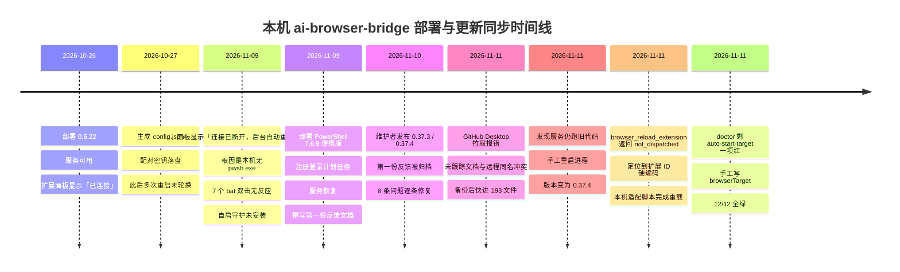
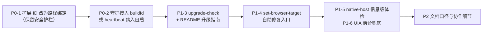

# 本机部署 / 使用 / 更新同步现场问题报告（Windows 11，2026-11-11）

> **归档说明（2026-11-11，维护者复核于 v0.38.0 / `3802e3e`）**：原文来自 `LOVE-PC-WIN11` / `D:\Project\ai-browser-bridge`，现场版本 0.37.4 (`85e6119`)；作者已 `git fetch` 到 `3802e3e` / v0.38.0 并逐文件核对，**原文保留在下，未改动一字**。
>
> **归档改名理由（实践本文 P2-8）**：原文件名 `docs/LOCAL-FIELD-REPORT-2026-11-11-win11-deploy-upgrade.md` 是作者本机未跟踪的现场报告；若维护者用同名归档进仓库，作者下次 `git pull` 会再次撞上 "untracked working tree files would be overwritten"。故归档版改名为 `docs/FIELD-REPORT-LOVE-PC-WIN11-2026-11-11-deploy-upgrade.md`（带机器标识、不同文件名），本机现场报告则约定放 `docs/local/`（该目录自带 `.gitignore`）。**保留在 `docs/` 根目录**是必要的：正文有多处指向同目录文档的相对链接（§9 的 `DEPLOYMENT-FEEDBACK-2026-11-09.md`、`CHROME-VERSION-ADAPTATION.md` 等），移到子目录会让它们全部失效。文中 §6 表格自述的本地路径仍是作者机器上的原样，不代表本仓库路径。
>
> ### 逐条对账结论（对照本仓库 v0.38.0 源码）
>
> | ID | 结论 | 依据 |
> |---|---|---|
> | P0-1 扩展 ID 硬编码 | **成立** | `src/chrome-profile.js:46`、`src/desktop-adapter.js:10,190`、`scripts/reload-extension.ps1:2,57`、`scripts/clear-extension-errors.ps1:2` 均写死 `mmop…`；另有一处报告未列出：`src/desktop-adapter.js:76` 的 `mapReloadResult` 成功结果也回显该常量（本轮一并改为真实 ID）。`src/server.js:1087` 调 `reloadExtension(args)` 未传握手保存的真实 ID（`:586`、`:1912-1918`），而原生宿主链路 `:950` 用的是真实 ID。`findBridgeExtension()`（`:59-83`）已具备 `byPath` + `byId` 双匹配，修复基础已有 |
> | P0-2 守护只探活 | **成立** | `scripts/watch-service.ps1:42-46` 仅判 `health.service`；`src/heartbeat.js:205-210` 确有 `build_stale` → `build_restart`，但默认自启链路未接入 |
> | P1-3 缺升级自检 | **成立** | `src/cli.js:262` 只有 `diagnose-upgrade`，`upgradeDiagnosis()`（`:149-173`）只读 `audit.jsonl` + 回归/用量摘要；`README.md:99-101` 升级指南停在 0.5.10 |
> | P1-4 browserTarget 无自助修复 | **成立** | `src/cli.js:103` 的 recommendation 是散文，无命令、无字段结构 |
> | P1-5 native-host 无体检 | **成立** | doctor 12 项无此项；`extension/manifest.json:32` 确有 `nativeMessaging` |
> | P1-6 UIA 前台无兜底 | **成立** | `scripts/reload-extension.ps1:98-102` 单次 `SetForegroundWindow`，失败即 `exit 2`；判定与拒绝正确，缺兜底 |
> | P2-7 / P2-8 / P2-10 | **成立**（文档/诊断口径） | README 顶部无版本标记说明；本机报告与远程归档同名冲突；`doctor-host-env.mjs` 未去重 `NO_PROXY` |
> | P2-9 计划任务自启 | **已知设计取舍** | 0.37.3 起明确「只检测并如实报告，不自动注册或删除外部任务」；本轮按用户授权做成可选开关 |
>
> ### 三处不能照抄原文建议的地方
>
> 1. **P0-2 建议 4「新增 `source-build-match`」是重复造轮子**：`src/cli.js:37` 的 `service-build-current` **已经**在比对 `status.buildId === computeBuildIdentity(ROOT)`，`:38` 也已给「空闲时安排重启」的建议。真正缺的是**可复制命令**与「pull ≠ 升级完成」的文档口径，不是新检查项。
> 2. **P0-1 建议 3「PowerShell 护栏改成只校验 ID 格式」会放宽安全边界**：现状拒绝一切非固定 ID，是有意的防护（防止工具被诱导重载任意扩展）。正确做法是 **Node 侧**用 `findBridgeExtension({extensionDir})` 验证「该 ID 在 Chrome Preferences 中的 path 确实指向本项目 `extension/`」，再把校验后的 ID 连同可信来源证据传给脚本；脚本仍须拒绝未经校验的目标，**不能只验 `^[a-p]{32}$`**。
> 3. **P0-2 建议 1「让 watchdog 每 10 秒比对 buildId 就直接重启」与 heartbeat 的严格前置冲突**：项目白名单自愈要求「完全空闲 + 冷却 3 周期 + 单实例锁 + 动作后 recheck」，watchdog 看不到 in-flight 命令，且开发期间有人改 `src/*.js` 会造成反复重启、打断并行会话。本轮改为「复用 `service-build-current` 检出 → `upgrade-check` 给有序步骤 → 可选 `-Heartbeat` 把 heartbeat 常驻纳入自启（自动重启仍走 heartbeat 白名单）」，**不在 watchdog 里裸重启**。
>
> 本轮执行口径：用户选择按 §5 的 M1→M4 做完 10 项；实施结果见 `CHANGELOG.md` 与本文末尾的维护者补充（如追加）。第一份反馈的归档见 [`docs/DEPLOYMENT-FEEDBACK-2026-11-09.md`](DEPLOYMENT-FEEDBACK-2026-11-09.md)。

> **反馈对象**：ai-browser-bridge 维护者
> **机器标识**：`LOVE-PC-WIN11` / `D:\Project\ai-browser-bridge`（下文简称「本机」）
> **记录时间**：2026-11-11（GMT+8）
> **性质**：第二份现场反馈，聚焦**部署 → 长期使用 → 远程更新同步**全链路；第一份见 [`DEPLOYMENT-FEEDBACK-2026-11-09.md`](DEPLOYMENT-FEEDBACK-2026-11-09.md)（已被维护者归档并加复核说明，其 §3 的 8 条问题在 0.37.3 已修复）。
> **口径**：本文所有 `文件:行号` 均指本机现场版本 **`85e6119` / 0.37.4**。撰写时已 `git fetch` 到远程 **`3802e3e` / v0.38.0**，并逐个核对：涉及本文问题的 `src/cli.js`、`scripts/watch-service.ps1`、`src/desktop-adapter.js`、`src/chrome-profile.js`、`scripts/reload-extension.ps1`、`scripts/clear-extension-errors.ps1`、`doctor-lite.bat`、`scripts/check-runtime.bat` **在 v0.38.0 中均未改动**，因此结论对新版同样成立。`README.md` 在 v0.38.0 仅把首段版本号 0.37.4 改成 0.38.0，§「当前版本升级指南」正文仍停留在 0.5.10。
> **说明**：本报告只描述现象、证据与建议，**没有修改任何项目源码**；本机为绕过问题所做的临时改动全部列在 §6，便于维护者区分「产品行为」与「本机补丁」。全文不含任何密钥、Cookie、页面正文或用户数据。

---

## 0. 一页摘要（TL;DR）

三句话结论：

1. **0.37.3 的修复是有效的**：本机实测 `doctor` 12/12、`doctor-lite` 6/6，双击入口不再静默失败，面板「从未连上」文案、`runtime.json` 固化路径、自启注册清单都按预期工作。上一份反馈的 8 条问题逐条验证通过，这部分是明确的正面结果。
2. **剩下的摩擦几乎全部集中在「更新同步」这一环**：`git pull` 之后，服务进程仍跑旧代码、扩展仍加载旧清单、配置缺新字段，用户需要人工串联「重启服务 → 重载扩展 → 补配置 → 复跑体检」四步；项目已有的 `heartbeat` 完全具备 `build_stale` 检测能力，但**默认自启链路没有接入它**。
3. **最硬的一个 bug 是扩展 ID 硬编码**：解压扩展的 ID 由绝对路径派生，本机实际是 `gklebbcjecmlmcdihciilbmjjbmjggip`，而 4 处生产代码写死 `mmopbppo…`。服务本身已经从握手拿到了真实 ID（`/status.extensionId`），却没有把它传给 UI 重载链路，导致官方 `browser_reload_extension` 在这台机器上返回 `not_dispatched`。

优先级总表（「v0.38.0」列 = 该问题在远程最新代码里是否仍存在）：

| ID | 阶段 | 级别 | 一句话 | v0.38.0 |
|---|---|---|---|---|
| P0-1 | 更新同步 | 阻断 | 解压扩展 ID 硬编码，UIA 重载 / 清错链路在非标准路径必然失效 | 仍存在 |
| P0-2 | 更新同步 | 高 | 默认守护只探活不比 `buildId`，pull 后旧进程继续服务 | 仍存在 |
| P1-3 | 更新同步 | 高 | 缺一条「升级自检 + 有序步骤」命令，README 升级指南停在 0.5.10 | 仍存在 |
| P1-4 | 使用 | 中高 | 旧配置缺 `browserTarget` → `auto-start-target` 报红且无自助修复命令 | 仍存在 |
| P1-5 | 使用 | 中 | manifest 新增 `nativeMessaging`，但 doctor 不体检宿主、README 无取舍说明 | 仍存在 |
| P1-6 | 更新同步 | 中 | UIA 前台获取在后台 / 工具会话里被 Windows 前台锁挡住 | 仍存在 |
| P2-7 | 协作 | 中 | `0.5.x` / `0.37.x` 两套版本标记并行，跨线升级看起来像「降级」 | 仍存在 |
| P2-8 | 更新同步 | 低 | 本地生成的反馈文档与远程归档同名 → GitHub Desktop 拒绝覆盖 | 仍存在 |
| P2-9 | 部署 | 低 | 官方无人值守自启仍未提供，现场必须自建计划任务（0.37.3 已标注延后） | 仍存在 |
| P2-10 | 环境 | 低 | 大小写重复的代理变量让 PS 5.1 报错；`doctor-lite` 在注入式会话里会误报一项 | 仍存在 |

> 一个直观的体感数据：本次「拉远程更新 + 让扩展真正生效」总共花了约 40 分钟，其中真正属于 `git pull` 的不到 1 分钟，其余全部花在「发现拉下来的代码没有生效」「找出为什么官方重载点不到按钮」「补新版本配置字段」上。**代码更新是自动的，版本生效是手工的** —— 这是本文最希望被修的一点。

---

## 1. 环境与代码基线

### 1.1 机器

| 项 | 实测值 |
|---|---|
| 操作系统 | Microsoft Windows 11 专业版，`10.0.28000` |
| Node | `v22.22.2`（两份并存，见 §1.3） |
| PowerShell | Windows PowerShell 5.1（系统自带）+ PowerShell **7.6.9** 便携版（本机为解决部署问题后装） |
| 便携运行时目录 | `C:\Users\love\AppData\Local\Programs\AIBridgeRuntime\`（`pwsh.exe` + `node.exe`，已写入用户级 PATH） |
| Chrome | `157.0.8103.51`，默认档案 `Default` |
| Chrome 可执行文件 | `C:\Users\love\AppData\Local\Google\Chrome\Application\chrome.exe` |
| 用户级 `NO_PROXY` | `127.0.0.1,localhost,::1` |
| 服务监听 | `127.0.0.1:19387`，本次复核时 PID `23288` |
| 登录自启 | 启动文件夹快捷方式（项目安装器）+ 计划任务 `AI Browser Bridge Watchdog`（本机自建，状态 `Running`） |

### 1.2 项目 / 仓库

| 项 | 实测值 |
|---|---|
| Remote | `https://github.com/love530love/ai-browser-bridge.git` |
| 本地 HEAD | `85e6119`（0.37.4，2026-11-10） |
| 远程 HEAD | `3802e3e`（v0.38.0，2026-11-11，tag `v0.38.0`） |
| 同步状态 | `## main...origin/main [behind 1]`，工作区干净 |
| 克隆 | `git rev-parse --is-shallow-repository` = **true**（浅克隆） |
| 本次 pull 前 | `fddcb1d`，落后 `origin/main` **62** 个提交 |
| 本次 pull | `git pull --ff-only origin main` → `85e6119`，快进 **193** 个文件 |
| 扩展实际 ID | **`gklebbcjecmlmcdihciilbmjjbmjggip`**（解压路径 `D:\Project\ai-browser-bridge\extension`） |
| 扩展 ID 来源证据 | Chrome `Default/Secure Preferences` → `extensions.settings` → `path=D:\Project\ai-browser-bridge\extension` |
| 工具数量 | 升级前 51 → 升级后 **124** |

> **本次报告没有执行 `git pull` 到 v0.38.0**：为了把现场证据锚定在真实跑过的 0.37.4 上，只做了 `git fetch` + 对远程树逐文件核对。

### 1.3 一个必须写清楚的背景：两套版本标记

本机部署时是 **0.5.22**（见 `docs/DEPLOYMENT-2026-10-26.md`），一次快进后 `package.json` / `manifest.json` 变成 **0.37.4**。维护者在上一份文档的归档说明里已经指出：

> 项目内长期并行存在 `0.5.x`（功能叙述）与 `0.37.x`（工程版本）两套版本标记，**不能据版本号判断代码新旧**。

从使用者视角，GitHub Desktop 里看到的是「从 0.5.22 更新到 0.37.4」，直觉上像降级；`CHANGELOG.md` 0.37.3 又写着「它记录的环境是 0.5.22 / `D:\Project\ai-browser-bridge`，与本仓库版本线不同」，容易让人以为本地和远程是两个仓库。实际上 `git remote -v` 指向同一个 URL，本地就是快进到 0.37.4 的这份代码。这个沟通成本在 §4 P2-7 单独列为一条建议。

### 1.4 报告撰写时的健康快照（全部为真实命令输出）

```json
// node src/cli.js status（字段裁剪）
{
  "service": "ai-browser-bridge",
  "version": "0.37.4",
  "buildId": "c8791fe5f55f",
  "extensionVersion": "0.37.4",
  "extensionId": "gklebbcjecmlmcdihciilbmjjbmjggip",
  "connected": true,
  "browserVersion": "157.0.8103.51",
  "hostCount": 1,
  "nativeHostName": "com.aibridge.host"
}
```

```
node src/cli.js doctor        → ok=true  checks=12  failed=[]  recommendations=0
node scripts/doctor-host-env.mjs --json
                              → ok=true  passed=6  failed=0  unknown=0
Get-ScheduledTask 'AI Browser Bridge Watchdog' → State=Running
```

也就是说：**本机现在是完全可用的、体检全绿的状态**。下面写的是达到这个状态的过程中付出的代价，以及下次升级还会重演的部分。

---

## 2. 时间线



| 时间（GMT+8） | 事件 | 用户可见现象 | 实际耗时占比 |
|---|---|---|---|
| 10-26 | 0.5.22 全栈部署验收通过 | 面板「已连接」 | — |
| 11-09 | 某次重启后服务未再启动 | 「连接已断开，后台自动重连中」+「尚无操作」 | 排障约 80% 时间花在定位 `pwsh.exe` 缺失 |
| 11-09 | 便携运行时 + 计划任务自启落地 | 角标 `ON`，`doctor` 10/10 | — |
| 11-11 20:07 | GitHub Desktop 报错 | 「untracked working tree files would be overwritten by merge」 | 备份 + 比对 + pull |
| 11-11 20:11 | 重启服务到新代码 | `/status.version` 才从 0.5.22 变 0.37.4 | 需人工 kill 旧进程 |
| 11-11 20:13 | 官方重载工具失败 | `not_dispatched` / `desktop_target_not_unique_or_unavailable` / 15.0s | 定位 ID + 前台锁 |
| 11-11 20:20 | 本机适配脚本重载成功 | 扩展 0.37.4，新 session，工具 124 | — |
| 11-11 20:2x | 补 `browserTarget` | `doctor` 12/12 | 需手改 JSON |

---

## 3. 已修复项的现场验证（正面结果）

上一份反馈的 8 条问题，维护者在 0.37.3 逐条对账修复，本机在**完成 0.37.4 升级之后**逐条复验：

| 上一份条目 | 0.37.3 处置 | 本机复验证据 |
|---|---|---|
| P0-1 PowerShell 7 依赖未声明 | README 显式声明 + `scripts/check-runtime.bat` | `doctor-lite` 的 `pwsh-7 = ok`，解析到便携版 `pwsh.exe` |
| P0-2 双击入口静默失败 | 7 个 `.bat` 统一失败落日志 + `pause` + 非零退出码 | `start.bat` / `status.bat` / `doctor.bat` 均含 `BRIDGE_EXIT` 检查与 `.local/launcher-error.log`；成功路径不阻塞 |
| P1-3 `doctor` 只体检运行时 | 新增零 pwsh 依赖的 `doctor-lite.bat` + `doctor-host-env.mjs` | 6/6 通过，含端口四态、自启清单、`NO_PROXY` 检查 |
| P1-4 面板「从未连上」误导 | `hasEverConnected`（`chrome.storage.session`） | `extension/worker.js:42-54,400-401,1835` 已实现，自动重连保留 |
| P1-5 自启安装 / 卸载不闭环 | `.local/autostart-registry.json` + `-StatusOnly` | 清单存在且正确报告「外部计划任务只报告不改动」 |
| P2-6 运行时路径依赖会话 PATH | `.local/runtime.json` + `resolve-runtime.ps1` | `runtime-pinned = ok`，三个入口共用固化路径 |
| P2-7 代理吞掉 loopback | 两处 `Invoke-RestMethod -NoProxy` | `scripts/watch-service.ps1:41` 已带 `-NoProxy`；用户级 `NO_PROXY` 生效 |
| P2-8 缺重启验收清单 | README 补对照表与验收清单 | 已在 README 对应章节可见 |

另外 0.37.4 对「清错失败分支把 unknown 说成否定事实、还诱导再重载一次」的修正（CHANGELOG 0.37.4）方向非常对：本机第一次重载失败时，确实差点按返回文案再点一次，而那会造成第二次无谓重载。**这种「不确定的写不得盲目重放」的契约，是项目里最值得保留的设计之一。**

特别值得肯定的是维护者的工作方式：0.37.3 归档说明里写了「逐条对账后确认 8 条全部或大部分成立」「额外发现两处原文未覆盖的事实」，v0.38.0 CHANGELOG 又写了「动手前先逐条与 0.37.4 源码对账，改准了 5 处过时断言」。**先核证据再改代码，不把反馈当需求单照抄** —— 这份严谨让第二份反馈值得继续写。

---

## 4. 仍存在的问题（逐条定位）

统一模板：**现象 → 复现 → 证据（文件:行号 + 输出）→ 根因 → 建议 → 验收标准 → 影响边界**。

---

### P0-1 · 解压扩展 ID 被硬编码，官方 UIA 重载在非标准路径必然失败

**级别**：P0（功能在任何解压到不同路径的机器上失效）
**阶段**：更新同步
**v0.38.0**：仍存在（4 个文件未改动，已核对远程树）

#### 现象

按官方升级流程调用：

```bash
node src/cli.js call browser_reload_extension \
  '{"confirmation":"reload_extension_once","allowFocus":true}'
```

返回 `not_dispatched`，没有派发任何 UI 动作。随后在 Chrome 里看到打开的是一张**空扩展详情页**，找不到「重新加载」按钮。

#### 复现

1. 把项目解压到**非维护者开发机路径**（本机 `D:\Project\ai-browser-bridge`）。
2. Chrome 以「加载已解压的扩展程序」加载 `extension\`。
3. 让扩展处于**断连**状态（或加载的是不支持自我重载的旧扩展，本机升级前是 0.5.22），从而走 Windows UIA 回退路径。
4. 调用 `browser_reload_extension` → 必然失败。

#### 证据

```text
# .local/logs/audit.jsonl（2026-11-11 12:13 UTC = 20:13 GMT+8）
{"tool":"browser_reload_extension","outcome":"error","resultStatus":"not_dispatched",
 "dispatched":false,"errorCategory":"desktop_target_not_unique_or_unavailable","durationMs":15038}
```

```js
// src/chrome-profile.js:43-46 —— 注释里的前提不成立
// The id of an unpacked extension is derived from its absolute path, so it is
// stable for this project and is the fallback key when Chrome has stripped the
// path out of the record.
export const BRIDGE_EXTENSION_ID = 'mmopbppoabmhliflinadkgnedjpmbgig';
```

```js
// src/desktop-adapter.js:10,190 —— 常量直接传给 PowerShell
export const BRIDGE_EXTENSION_ID = 'mmopbppoabmhliflinadkgnedjpmbgig';
const args = ['-ExtensionId', BRIDGE_EXTENSION_ID, '-ChromeWindowHandle', String(windowHandle), '-BestEffort'];
```

```powershell
# scripts/reload-extension.ps1:2,57-62 —— 默认值 + 安全护栏
[string]$ExtensionId = 'mmopbppoabmhliflinadkgnedjpmbgig'
$fixedExtensionId = 'mmopbppoabmhliflinadkgnedjpmbgig'
if ($ExtensionId -ne $fixedExtensionId) {
  $message = 'This script only operates on the fixed AI Browser Bridge extension; no UI action was taken.'
  if ($BestEffort) { Write-Warning $message; exit 2 }
  throw $message
}
# :97 —— 打开的是「不存在」的详情页
$targetUrl = "chrome://extensions/?id=$ExtensionId"
```

```powershell
# scripts/clear-extension-errors.ps1:2,20,287 —— 同一常量用于错误页证据位
[string]$ExtensionId = 'mmopbppoabmhliflinadkgnedjpmbgig'
if ([string]::IsNullOrWhiteSpace($RequireUrlContains)) { $RequireUrlContains = "errors=$ExtensionId" }
if ($target.Address -and $target.Address.Contains($RequireUrlContains)) { $errorsQueryVisible = $true }
```

**最关键的证据是：服务其实已经知道真实 ID，只是没往下传。**

```js
// src/server.js:143,556,1864-1870 —— 从握手保存真实 ID
let extensionId = null;
extensionId = primary?.extensionId ?? null;
extensionId: typeof msg.extensionId === 'string' && /^[a-p]{32}$/.test(msg.extensionId) ? msg.extensionId : null,
if (record.extensionId) extensionId = record.extensionId;

// src/server.js:1039 —— 调重载时却没有带 extensionId
return desktopAdapter.reloadExtension(args);

// src/server.js:902-903 —— 原生宿主链路反而是用真实 ID 的
const extensionIdArg = typeof args.extensionId === 'string' && args.extensionId ? args.extensionId : (extensionId ?? '');
```

```js
// extension/worker.js:765 —— 扩展侧用的是 chrome.runtime.id（真实 ID）
const url = `chrome://extensions/?errors=${chrome.runtime.id}`;
```

本机实测：

```text
/status.extensionId                     = gklebbcjecmlmcdihciilbmjjbmjggip
Chrome Secure Preferences 中的 path      = D:\Project\ai-browser-bridge\extension
browser_native_host.expectedOrigin      = chrome-extension://gklebbcjecmlmcdihciilbmjjbmjggip/
四个生产文件里写死的 ID                  = mmopbppoabmhliflinadkgnedjpmbgig
```

即：**扩展侧、原生宿主侧用真实 ID，服务侧保存了真实 ID，唯独 Windows 桌面适配链路用固定 ID**，三套口径不一致。`worker.js:765` 打开 `?errors=<真实ID>`，而清错脚本期望 `errors=<固定ID>`，导致 `errorsQueryVisible` 这个证据位恒为 false（虽然按 `clear-extension-errors.ps1:271-273` 注释它不参与强制判定，但会让「错误列表是否已展开」的可观测性失真）。

#### 根因

`chrome-profile.js:43-45` 的注释把「由绝对路径派生」误推成「本项目稳定」。实际只在维护者开发机那一份路径下稳定；任何换盘符、换目录、多副本部署、worktree，ID 都会变。安全护栏（`:58` 拒绝其他 ID）本身是**正确的设计**——防止工具被诱导重载任意扩展——但判据选错了对象：它校验「ID 是否等于常量」，而不是「这个 ID 是否确实属于本项目的解压目录」。

#### 建议（保留护栏，替换判据）

1. 复用项目已有的 `findBridgeExtension()`（`src/chrome-profile.js:59-75` 已经支持 `byPath` 匹配），把「握手 ID」与「Chrome Preferences 中 path 指向本项目 `extension/` 的 ID」做双重校验。
2. 把校验后的 ID 沿调用链传下去：

```js
// src/server.js:1039 附近
const reloadId = extensionId ?? BRIDGE_EXTENSION_ID;
return desktopAdapter.reloadExtension({ ...args, extensionId: reloadId });

// src/desktop-adapter.js:189 附近
const args = ['-ExtensionId', extensionId ?? BRIDGE_EXTENSION_ID,
              '-ChromeWindowHandle', String(windowHandle), '-BestEffort'];
```

3. PowerShell 侧把「等于常量」改成「属于本项目」：

```powershell
# scripts/reload-extension.ps1:57 附近的护栏，保留拒绝语义，改校验依据
# 由 Node 侧完成 path 绑定后，把 -ExtensionId 与 -ExpectedExtensionPath 一起传入；
# 脚本只接受「ID 格式合法」且「调用方已由可信来源校验」的值，仍拒绝任何 UI 越权目标。
param(
  [string]$ExtensionId,
  [string]$ExpectedExtensionPath = (Join-Path $projectRoot 'extension')
)
if ($ExtensionId -notmatch '^[a-p]{32}$') {
  $message = 'Extension id is malformed; no UI action was taken.'
  if ($BestEffort) { Write-Warning $message; exit 2 }
  throw $message
}
```

4. `clear-extension-errors.ps1` 增加 `-ExtensionId` 透传，`src/extension-errors.js:36-40` 构造 args 时从服务侧传入同一个 ID，让 `errorsQueryVisible` 恢复真实含义。
5. 顺带把 `docs/CHROME-VERSION-ADAPTATION.md:65`、`docs/WORKBUDDY-NOTICE-2026-10-01.md:9` 里写死 ID 的说明改为「以 `/status.extensionId` 为准」。

#### 验收标准

| # | 条件 | 期望 |
|---|---|---|
| 1 | 解压到任意路径，读 `/status.extensionId` | 返回该路径对应的真实 ID，不是常量 |
| 2 | 断开扩展后调用 `browser_reload_extension` | `verified:true` / `dispatched:true` / 新 session / 版本匹配 |
| 3 | 传入一个**不属于本项目**的合法 ID | 仍被拒绝（安全护栏不得放宽） |
| 4 | 自我重载后的清错步骤 | `errorsQueryVisible` 与真实 URL 一致，不恒为 false |

#### 影响边界（避免夸大）

扩展**已连接**且版本较新时走 `chrome.runtime.reload()` 自我重载（`src/server.js:1101-1113`），不依赖 ID 常量，因此日常升级不受影响。本机之所以撞上，是因为升级前加载的是 0.5.22（没有自我重载分支），必须走 UIA 回退。**这条 bug 专打「最需要被救」的场景：扩展断连 / 跨大版本升级 / 服务与扩展版本错位。**

---

### P0-2 · 默认守护只探活不比 `buildId`，`git pull` 后旧代码继续服务

**级别**：P0（用户会误以为已经升级完成）
**阶段**：更新同步
**v0.38.0**：仍存在（`scripts/watch-service.ps1`、`src/cli.js` 未改动）

#### 现象

`git pull --ff-only` 成功、193 个文件更新、工作区干净，但 `/status.version` 仍是 **0.5.22**，工具数仍是 51。用户看到「拉取成功」+ 面板「已连接」，完全看不出磁盘代码和内存代码不是同一份。

#### 复现

1. 服务由登录自启的 `scripts/watch-service.ps1` 拉起并保持运行。
2. `git pull` 快进多个提交。
3. 不手工杀进程，反复执行 `node src/cli.js status` → 版本恒定不变。
4. 守护每 10 秒巡检一次，报告 `state=connected`，一切正常。

#### 证据

```powershell
# scripts/watch-service.ps1:41-46 —— 健康判据只有 service 字段与 connected
try { $health = Invoke-RestMethod -Uri "http://127.0.0.1:$($config.port)/status" `
      -Headers @{Authorization="Bearer $($config.agentToken)"} -TimeoutSec 3 -NoProxy } catch { }
if ($health.service -eq 'ai-browser-bridge') {
  $failures = 0
  if ($health.maintenance) { Report-State 'maintenance' }
  elseif ($health.connected) { Report-State 'connected' }
  else { Report-State 'service-healthy-extension-disconnected' }
}
```

**能力其实已经有了，只是没接进默认链路：**

```js
// src/heartbeat.js:205-210
if (disk.diskBuildId && status.buildId && status.buildId !== disk.diskBuildId) {
  rules.push(finding('build_stale', 'critical',
    { runningBuildId: status.buildId, diskBuildId: disk.diskBuildId, pid: disk.pid },
    'The running process was started from a different source tree. Restart it through the watchdog so the new code takes effect.',
    { kind: 'build_restart' }));
}
```

README:144 也写明 `heartbeat` 会「与源码 buildId 比对，异常时……只自动执行两个白名单动作（源码陈旧时经看门狗重启服务、扩展落后时按 hostId 重载）」。但 `install-autostart.ps1` 注册的是 `watch-service.ps1`，`heartbeat --watch` 需要用户自行常驻（README 原话：「可由用户自行常驻」）。**默认部署里没有任何一条路径会执行 `build_restart`。**

本机处置：手工 `Stop-Process -Id <listenerPid> -Force`，守护在约 10 秒内用新 `start.ps1` 拉起 `/status.version=0.37.4`、`buildId=c8791fe5f55f…`。

#### 根因

守护的职责被定义成「服务是否应答」，没有把「运行中的代码 = 磁盘上的代码」纳入健康定义。而项目里 `buildId` 机制本来就是为此设计的，只是放在了可选的心跳巡检里。

#### 建议

1. **最小改动**：让 `watch-service.ps1` 在每次巡检时顺带比对 `buildId`，不一致时按现有白名单动作重启一次，并写一条明确状态：

```powershell
# scripts/watch-service.ps1:42 分支内，示意
if ($health.service -eq 'ai-browser-bridge') {
  $diskBuild = & $node (Join-Path $root 'src\cli.js') heartbeat --json | ConvertFrom-Json
  if ($diskBuild.diskBuildId -and $health.buildId -and $health.buildId -ne $diskBuild.diskBuildId) {
    Report-State 'stale-build-restarting'
    # 复用 heartbeat 的 build_restart 白名单动作；不要按进程名 kill，
    # 也不要调 stop.ps1（它会写 service-paused，让守护自我暂停）。
    ...
  }
}
```

2. **装配改动**：`install-autostart.ps1` 增加 `-Heartbeat` 可选开关，把 `node src/cli.js heartbeat --watch --interval-ms 60000` 纳入自启注册清单与 `autostart-registry.json`，`uninstall-autostart.ps1` 同步清理。
3. **文档改动**：README 的「当前版本升级指南」明确写一句「`git pull` 之后必须重启服务，否则仍在跑旧进程；可用 `doctor` 的 `buildId` / `version-match` 确认」。
4. `doctor` 的 `version-match`（`src/cli.js:121`）目前只比「服务版本 vs 扩展版本」，**不比「服务 buildId vs 磁盘 buildId」**。建议增加一个 `source-build-match` 检查，让体检能直接回答「我拉下来的代码生效了吗」。

#### 验收标准

| # | 条件 | 期望 |
|---|---|---|
| 1 | 服务运行时 `git pull` 一个改了源码的提交 | 60 秒内 `/status.version` 与 `package.json` 一致，无需人工干预 |
| 2 | 重启动作 | 只发生一次，日志有 `stale-build-restarting` → `startup-completed`，不写 `service-paused` |
| 3 | `doctor` | 能区分「服务/扩展版本不一致」与「服务/磁盘源码不一致」 |
| 4 | 端口被无关程序占用 | 维持现有保守行为（`port-occupied-or-service-unresponsive`），不盲杀 |

---

### P1-3 · 缺「升级自检 + 有序步骤」入口，README 升级指南停留在 0.5.10

**级别**：P1
**阶段**：更新同步
**v0.38.0**：仍存在（README 仅改首段版本号）

#### 现象

升级时需要在脑子里串起四件事，漏一件就会出现「能连但不对」的假健康状态：

```
git pull（磁盘代码）
  → 重启服务进程（内存代码 / buildId）
  → 重载 Chrome 解压扩展（manifest 新权限、worker 新代码）
  → 迁移 .local/config.json 新增字段（本次是 browserTarget）
  → doctor + doctor-lite 复验
```

#### 证据

```text
README.md:99  「### 当前版本升级指南」
README.md:101 「0.5.10：在 0.5.9 基础上增加 SPA 零尺寸布局诊断……完整历史见 CHANGELOG.md」
README.md:113 「### 历史：从 0.1.0 更新到 0.1.1」—— 只讲「在 chrome://extensions 点重新加载」
README.md:184 「扩展更新后，在 Chrome 扩展页点'重新加载'」
```

`src/cli.js:262` 有 `diagnose-upgrade`，但 `upgradeDiagnosis()`（`:149-175`）只读 `audit.jsonl` 做错误分类与「升级前是否适合升级」的回归摘要，**不检查版本/buildId/配置字段，也不产出升级步骤**。CLI 里没有 `upgrade-check` 之类的命令。

本机实际靠人工串了 8 步，其中「重载扩展」还额外撞上 P0-1、P1-6 两个问题。

#### 建议

1. 新增只读的 `node src/cli.js upgrade-check`，输出结构化差异与**有序、可复制**的步骤：

```json
{
  "git": { "head": "85e6119", "behind": 1, "dirty": false },
  "disk": { "version": "0.37.4", "manifestVersion": "0.37.4", "buildId": "c8791fe5f55f" },
  "running": { "version": "0.37.4", "buildId": "c8791fe5f55f", "extensionVersion": "0.37.4" },
  "config": { "missingFields": ["browserTarget"] },
  "extensionId": "gklebbcjecmlmcdihciilbmjjbmjggip",
  "steps": [
    "1. git pull --ff-only origin main",
    "2. 服务 buildId 落后：重启服务（或等待守护检测到 stale build）",
    "3. 扩展版本落后：调用 browser_reload_extension（已连接时会自动自我重载）",
    "4. 补齐配置字段：node src/cli.js set-browser-target --from-running-chrome",
    "5. 复验：doctor-lite.bat → doctor.bat"
  ]
}
```

2. README「当前版本升级指南」更新到当前版本，并把上面 5 步写成固定清单；明确「**只 pull 不等于升级完成**」。
3. `doctor` 的 `recommendations`（`src/cli.js:127-130`）现在给的是自然语言建议，建议附 `command` 字段，让 Agent / 用户能直接复制执行。

#### 验收标准

- 一条 `upgrade-check` 能准确指出「哪一层落后」，且每条建议都带可复制命令。
- 按输出的步骤执行完，`doctor.ok === true` 且 `running.buildId === disk.buildId`。

---

### P1-4 · 旧配置升级后 `auto-start-target` 报红，但没有自助修复入口

**级别**：P1
**阶段**：使用 / 升级后首次体检
**v0.38.0**：仍存在（`src/cli.js` 未改动）

#### 现象

升级后 `doctor` 12 项里 11 项通过，唯一红项是新增的 `auto-start-target`，`ok=false`。返回的建议是：

> "No browserTarget is recorded, so auto start picks a channel by heuristic... set browserTarget in config.json to the browser you actually use."

既没有命令，也没有字段结构示例，用户只能手工打开 JSON 编辑。

#### 证据

```js
// src/cli.js:86
add('auto-start-target', decision.reason === 'dry_run' && sameProfile !== false && !staleTarget, { ... });

// src/cli.js:102-104
if (!target) {
  report.recommendations.push('No browserTarget is recorded, ... set browserTarget in config.json ...');
}
```

本机 Chrome 档案 `Default` 里只有 `History`，没有 `Bookmarks` / `Login Data` 落盘数据，`scripts/launch-chrome.ps1` 的「只选有用过的档案」启发式因此返回 `no_used_profile_available`，`decision.reason` 不是 `dry_run`，检查判红。**但同一时刻 Chrome 正在运行**（主进程 PID 6796，路径明确）。也就是说，机器上有最强的证据（正在运行的浏览器进程），体检却没有用它。

本机最终写入的结构（供参考，也是希望 README 里能给出的示例）：

```json
{
  "browserTarget": {
    "exePath": "C:\\Users\\love\\AppData\\Local\\Google\\Chrome\\Application\\chrome.exe",
    "userDataDir": "C:\\Users\\love\\AppData\\Local\\Google\\Chrome\\User Data",
    "profileDirectory": "Default",
    "channel": "stable"
  }
}
```

写入后 `doctor` 12/12 全绿、0 建议。注意写入时曾因 Node 字符串转义把路径写成双反斜杠字面量，需要二次修正 —— 这恰好说明「让用户手改 JSON」这条路容易出错。

#### 建议

1. 加一条 `node src/cli.js set-browser-target --from-running-chrome`：从 `Win32_Process` 找到持有可见窗口的 `chrome.exe`，读 `ExecutablePath` 与命令行中的 `--user-data-dir` / `--profile-directory`（无参数时用默认路径），生成结构、校验文件存在、写回 `config.json`。
2. 或者退一步：`doctor` 在该检查失败时直接给出一段可复制的 PowerShell/Node 命令与 `browserTarget` 字段结构，而不是一句散文。
3. README 增加 `browserTarget` 字段说明与「为什么启发式会拒绝猜测」的简短解释。

> 保留现有启发式是对的：启动一个空白档案看起来像登录态被清空，风险远大于报红。这里要求补的是**修复入口**，不是放宽判定。

#### 验收标准

- 旧配置（无 `browserTarget`）升级后，用户不需要手改 JSON 即可让 `doctor.ok === true`。
- 生成的 target 与当前正在运行的 Chrome 档案一致（`sameProfileAsThisMachine: true`）。

---

### P1-5 · manifest 新增 `nativeMessaging`，但没人体检宿主、也没有取舍说明

**级别**：P1
**阶段**：使用
**v0.38.0**：仍存在

#### 现象

0.37.4 的 `extension/manifest.json` 权限列表包含 `nativeMessaging`（另有 `offscreen`、`identity` 等新增项）。Chrome 会据此显示权限，但用户不知道：这个宿主是**必须装**还是**可选**、不装会缺什么、装了会改注册表哪里。

#### 证据

```json
// node src/cli.js call browser_native_host '{}'（只读）
{
  "status": "success", "action": "status",
  "hostName": "com.aibridge.host",
  "registered": false, "manifestExists": false, "launcherExists": false,
  "hostScriptExists": true,
  "allowedOrigins": [], "extensionIdMatches": false, "usable": false,
  "expectedOrigin": "chrome-extension://gklebbcjecmlmcdihciilbmjjbmjggip/",
  "extensionId": "gklebbcjecmlmcdihciilbmjjbmjggip"
}
```

- 宿主**未注册**，但 `doctor` 12 项全绿——因为 12 项里没有 `native-host`。
- `browser_native_host_install` 工具存在，但升级流程、`doctor`、`README` 都没有提到它。
- 好的一面：`expectedOrigin` 用的是**真实 ID**（`src/server.js:902-903` 链路正确），这说明 P0-1 的修复只需把同一份 ID 复用到桌面链路。

#### 建议

1. `doctor` 增加 `native-host` **信息级**检查（标记 `optional: true`，未注册不影响 `ok`），输出「未注册 → 哪些能力不可用 → 安装命令」。
2. README 加一小节「原生消息宿主（可选）」：说明注册表位置 `HKCU:\Software\Google\Chrome\NativeMessagingHosts\com.aibridge.host`、安装/卸载命令、以及「只有用到剪贴板/原生能力才需要」。
3. `upgrade-check` 在 manifest 权限新增时提示「本次新增权限：…；如需 X 能力请安装宿主」。

#### 验收标准

- 用户能从 `doctor` 输出直接回答「我要不要装、怎么装、装完怎么验」。
- 未注册时 `doctor.ok` 仍为 true（可选能力不得变成阻断项）。

---

### P1-6 · UIA 前台获取在后台 / 工具会话里被 Windows 前台锁挡住

**级别**：P1
**阶段**：更新同步（UIA 回退路径）
**v0.38.0**：仍存在

#### 现象

第一次 UIA 调用能把 Chrome 切到前台，第二次从非交互的工具会话启动的进程，被 Windows 前台锁拒绝；脚本如实返回 `Could not verify the selected Chrome window is foreground; no keyboard input was sent` 并 `exit 2`。**判定与拒绝都是正确的**，缺的是获取前台的兜底手段。

#### 证据

```powershell
# scripts/reload-extension.ps1:18-19（NativeWindow 只声明了两个相关 API）
[DllImport("user32.dll")] public static extern bool SetForegroundWindow(IntPtr hWnd);
[DllImport("user32.dll")] public static extern IntPtr GetForegroundWindow();

# :98-103（单次调用，无重试、无线程输入附加）
$focused = [NativeWindow]::SetForegroundWindow($chromeWindow.Handle)
if (-not $focused -or [NativeWindow]::GetForegroundWindow() -ne $chromeWindow.Handle) {
  $message = 'Could not verify the selected Chrome window is foreground; no keyboard input was sent.'
  if ($BestEffort) { Write-Warning $message; exit 2 }
  throw $message
}
```

本机绕过方案（`.local/reload-extension-local.ps1`，被 `.gitignore` 忽略）加入了 `AttachThreadInput` + `ShowWindow(SW_RESTORE)` + `BringWindowToTop`，并在**最终仍校验 `GetForegroundWindow`** 之后才发送按键：

```csharp
public static void Force(IntPtr h) {
  IntPtr fg = GetForegroundWindow();
  uint pid;
  uint fgThread = GetWindowThreadProcessId(fg, out pid);
  uint my = GetCurrentThreadId();
  bool attached = fgThread != my && AttachThreadInput(my, fgThread, true);
  ShowWindow(h, 9);
  BringWindowToTop(h);
  SetForegroundWindow(h);
  if (attached) AttachThreadInput(my, fgThread, false);
}
```

补完之后同一台机器、同样从工具会话调用，重载一次成功。**安全语义没有放宽**：拿不到前台就绝不发按键。

#### 建议

把上述兜底合入官方脚本（保留最终前台校验），并允许一次短间隔重试；同时把「是否成功取得前台」写进返回结果，便于调用方区分「没找到按钮」与「没抢到前台」——这两者现在的 `reason` 都是 `desktop_target_not_unique_or_unavailable`，排障时不够用。

#### 验收标准

- 从计划任务 / 非交互会话 / 工具进程调用 UIA 重载，首次即成功。
- 抢前台失败时仍返回 `dispatched:false`，且返回体里带 `foregroundVerified:false` 之类的可区分证据。

---

### P2-7 · 两套版本标记带来的沟通成本

**级别**：P2
**阶段**：协作 / 更新同步

#### 现象与证据

- 本机 `docs/DEPLOYMENT-2026-10-26.md` 记录部署的是 **0.5.22**；一次 pull 后 `package.json` = **0.37.4**，GitHub Desktop 的变更列表看起来像「版本倒退」。
- `CHANGELOG.md` 0.37.3 写「它记录的环境是 0.5.22 / `D:\Project\ai-browser-bridge`，与本仓库版本线不同」，容易让使用者怀疑本地是不是另一个 fork；实际 `git remote -v` 就是本仓库。
- 维护者已在上一份文档归档说明里解释过两套标记，但那句话**埋在 docs 的一篇归档文档里**，README / CHANGELOG 顶部 / Release 说明里看不到。

#### 建议

在 README 顶部（版本号那一段）与 Release 模板各加一句固定说明：

> `package.json` / `extension/manifest.json` 的工程版本号与部分文档里的功能叙述版本号是两套标记，**不能据数字大小判断代码新旧**；以 `git HEAD`、`buildId` 与 `doctor` 为准。

更彻底的做法是择机统一版本号，但这属于产品决策，本条只要求把口径显性化。

---

### P2-8 · 本地生成的反馈文档与远程归档同名，GitHub Desktop 拒绝覆盖

**级别**：P2
**阶段**：更新同步

#### 现象

用户在本地写了 `docs/DEPLOYMENT-FEEDBACK-2026-11-09.md`（未跟踪），维护者把同一份内容归档进远程并加了复核说明。下次 `git pull` 时 Git 拒绝覆盖未跟踪文件，GitHub Desktop 弹出 "untracked working tree files would be overwritten by merge"，用户以为拉取失败、项目坏了。

#### 证据与处置

- `git status --porcelain -uall` 显示该文件为 `??`。
- 逐字比对后确认：远程版 = 本地原文 + 20 行归档前言，正文完全一致（比对命令见 §8）。
- 备份到 `.workbuddy/backups/DEPLOYMENT-FEEDBACK-2026-11-09.local-original-20261111.md` 后移除未跟踪文件，`git pull --ff-only` 成功，远程归档版落盘，无内容丢失。
- 仓库为浅克隆且落后 62 提交，GitHub Desktop 的报错信息里没有「先备份再移除」这类可操作指引。

#### 建议

1. 给「本机现场报告」留一个约定位置与命名，例如 `docs/local/<machine>-<date>-<topic>.md` 并在 `.gitignore` 里忽略，或在 README 写「反馈文档请命名带机器标识，避免与维护者归档同名」。
2. README / 排障表补一条：「遇到 untracked 文件冲突 → 先备份 → 确认远程版是否包含本地内容 → 再移除并 `git pull --ff-only`」。
3. 本文已按此建议命名（`docs/LOCAL-FIELD-REPORT-2026-11-11-win11-deploy-upgrade.md`）。

> 这条不是代码缺陷，是「项目鼓励用户写反馈」与「维护者把反馈归档进仓库」两者叠加后的必然碰撞。写进文档即可消除。

---

### P2-9 · 官方无人值守自启仍未提供（0.37.3 已明确延后）

**级别**：P2
**阶段**：部署

#### 现状

`install-autostart.ps1` 只写启动文件夹快捷方式，需要**用户登录且有交互式会话**。0.37.3 CHANGELOG 明确写了「官方计划任务式无人值守自启：本轮只检测并如实报告外部任务」「原文 §7 中额外注册 `AI Browser Bridge Watchdog` 是该部署环境的规避措施，不是项目自带能力」—— 维护者已经知道并做了取舍，这里只是补充一个真实数据点。

本机 `doctor-lite` 的输出印证了这一点：

```text
autostart-registry = ok  注册清单可读，共 1 项：startup-shortcut。
外部注册项仅报告、未做任何改动：启动文件夹快捷方式 present、
HKCU Run(AIBrowserBridge) absent、计划任务(AI Browser Bridge Watchdog) ...
```

本机自建的计划任务状态 `Running`，服务被强杀后约 10 秒自愈，跨多个独立会话仍存活。**这是本机「重启后长期可用」的唯一保障**。

#### 建议

既然现场普遍需要，考虑把「登录触发计划任务」做成官方可选开关（如 `install-autostart.ps1 -ScheduledTask`），并让 `autostart-registry.json`、`uninstall-autostart.ps1`、`doctor-lite` 三处同步覆盖。另外提醒：项目移动目录或删除便携运行时目录后，外部任务不会自动更新，README 的「迁移/卸载」章节可以加一句。

---

### P2-10 · 代理环境变量大小写重复（环境侧，诊断可更友好）

**级别**：P2 / 环境侧，**不是项目缺陷**
**阶段**：部署 / 诊断

#### 现象

WorkBuddy 一类的注入式会话会同时设置 `HTTP_PROXY` 与 `http_proxy`（值同为 `127.0.0.1:9778`）。Windows PowerShell 5.1 的大小写不敏感环境字典在 `Start-Process` / `Get-ChildItem Env:` 时会抛「已添加具有相同键的项」。0.37.3 已通过 `-NoProxy` 与用户级 `NO_PROXY` 解决了服务探活，这里只记录两个诊断口径上的小毛刺：

1. 在注入式会话里若 `NO_PROXY` 未随进程继承，`doctor-lite` 会误报 `no-proxy-loopback` 失败，而登录后的守护进程环境其实是干净的。
2. 本次复核时 `doctor-lite` 显示 `NO_PROXY` 当前值为 `127.0.0.1,localhost,::1,127.0.0.1,localhost,::1`（会话 `export` 与用户级变量叠加），虽然不影响功能，但输出读起来像配置错了。

#### 建议

`doctor-host-env.mjs` 对 `NO_PROXY` 做大小写归并 + 条目去重，并在检测到「同名大小写重复且值相同」时给一句说明「同值重复来自会话注入，不影响登录进程」；其余保持现状即可。

---

## 5. 建议的修复顺序与整体验收



| 批次 | 条目 | 为什么这个顺序 | 可验证验收 |
|---|---|---|---|
| M1 | P0-1、P0-2 | 两者共同决定「升级后到底跑的是不是新代码」；P0-1 还阻断最需要救援的断连场景 | 换盘符部署 + pull + 断连重载，全链路无需人工补丁 |
| M2 | P1-3、P1-4 | 把「人工串联」变成一条命令 + 一个自助修复入口 | `upgrade-check` 输出有序步骤；旧配置不手改 JSON 即 `doctor.ok` |
| M3 | P1-5、P1-6 | 提升可观测性与后台会话成功率 | doctor 能回答宿主取舍；后台会话 UIA 首次成功 |
| M4 | P2-7 ~ P2-10 | 文档与协作口径，成本最低 | README / Release / 排障表可检索到对应说明 |

**一条端到端验收脚本**（建议维护者在「解压到非默认路径 + 浅克隆 + 旧配置」的干净 Windows 机器上跑一次）：

```bash
# 1. 记录初始真实 ID 与 buildId
node src/cli.js status | grep -E '"extensionId"|"buildId"|"version"'

# 2. 模拟一次远程更新
git pull --ff-only origin main

# 3. 期望：无需人工 kill，服务自动切到新 buildId
node src/cli.js upgrade-check          # 建议新增
node src/cli.js status                 # buildId 应与磁盘一致

# 4. 期望：自动或半自动重载扩展到同一版本
node src/cli.js doctor                 # version-match / source-build-match 全过

# 5. 期望：旧配置无需手改 JSON
node src/cli.js set-browser-target --from-running-chrome   # 建议新增
doctor-lite.bat && doctor.bat          # 全绿
```

---

## 6. 本机为绕过问题所做的改动（重要：本机不是纯净环境）

维护者若远程协助排查，请注意以下都是**本机状态**，不是项目自带行为，也不应被当作复现前提：

| 路径 / 对象 | 内容 | 原因 |
|---|---|---|
| `C:\Users\love\AppData\Local\Programs\AIBridgeRuntime\` | PowerShell 7.6.9 便携版 + `node.exe` 副本，已加入用户级 PATH | 原机无 `pwsh.exe`，winget MSIX 安装失败（见第一份反馈 §附录） |
| 用户级 `NO_PROXY` | `127.0.0.1,localhost,::1` | 避免代理吞掉 loopback 探活 |
| 计划任务 `AI Browser Bridge Watchdog` | 登录触发，运行 `scripts\watch-service.ps1`，无执行时限、失败重启 3 次 | 官方安装器只写启动快捷方式（§4 P2-9） |
| `.local/reload-extension-local.ps1` | 官方脚本副本：ID 替换为本机真实 ID + `AttachThreadInput` 前台兜底 | 绕过 P0-1 与 P1-6；该文件被 `.gitignore` 忽略，不进 Git |
| `.local/config.json` | 新增 `browserTarget` 字段（结构见 §4 P1-4），**密钥未改动、未开启自动启动** | 绕过 P1-4 |
| `.local/runtime.json`、`.local/autostart-registry.json` | 0.37.3 安装器生成 | 项目自带能力，非手工补丁 |
| `.workbuddy/backups/DEPLOYMENT-FEEDBACK-2026-11-09.local-original-20261111.md` | 冲突文档的本地原文备份 | 保证 pull 不丢内容（§4 P2-8） |
| `docs/DEPLOYMENT-FEEDBACK-2026-11-09.md` | 已被远程归档版覆盖（含维护者复核前言） | 正文与本地原文逐字一致 |
| `docs/LOCAL-FIELD-REPORT-2026-11-11-win11-deploy-upgrade.md` | 本报告，未跟踪 | 带机器标识命名，避免再次同名冲突 |

**跟踪文件层面**：本次会话只做了 `git pull` 带来的 193 个更新 + `git fetch`，**没有改动任何项目源码、配置模板或文档正文**（本报告是新增的未跟踪文件）。`git status -sb` 为 `## main...origin/main [behind 1]`，工作区干净。

---

## 7. 值得保留的设计（不只是问题清单）

1. **配对密钥持久化**：从 10-27 生成至今，跨多次重启、跨 0.5.22 → 0.37.4 大版本升级、跨手工杀进程，**从未要求重新 `pair.bat`**。这是升级体验里最省心的一环。
2. **断线自愈**：重连退避 + `chrome.alarms` 唤醒；强杀服务进程后守护约 10 秒拉起，扩展自动重连成功，实测 `watchdog-state=connected`。
3. **体检的诚实口径**：`doctor-lite` 把「查不到」报 `unknown` 而不是 `failed`；`heartbeat` 的 `clean` 需要 buildId / 版本 / 连接 / 零 findings 全部有证据，否则一律 `uncertain`；0.37.4 把清错失败从「确认仍有错误」改成「状态 unknown，别再重载一次」。这类「不编造证据」的契约非常少见，也让本报告敢直接引用工具输出。
4. **安全边界**：只监听 `127.0.0.1`、Host 固定、拒绝普通网站 Origin、审计日志脱敏、UI 重载按 PID 绑定且歧义即拒绝、`stop.ps1` 校验进程身份后才 kill（不按名字杀）。修 P0-1 时**请务必保留这些护栏**，只换判据。
5. **反馈闭环**：上一份文档被归档、逐条对账、明确标注「未采纳/延后」，v0.38.0 又「先改准 5 处过时断言再动手」。这个项目对外部反馈的处理质量，是本文继续写第二份的直接原因。

---

## 8. 附录：原始证据

### A. 版本与健康

```text
$ git status -sb
## main...origin/main [behind 1]
$ git log --oneline -3
85e6119 fix: 0.37.4 clarify clear-step failure guidance, never suggest a second reload
fa67890 feat: 0.37.3 deployment diagnostics - launcher contract, host-env doctor, runtime pinning
58d4539 chore: 0.37.2 scheduler bridge wiring, /status hosts aggregation, e2e regression
$ git rev-parse --is-shallow-repository
true
$ node -e "console.log(require('./package.json').version, require('./extension/manifest.json').version)"
0.37.4 0.37.4
```

```text
$ node src/cli.js doctor
ok=true  checks=12  failed=[]  recommendations=0
$ node scripts/doctor-host-env.mjs --json
ok=true  passed=6  failed=0  unknown=0
  pwsh-7           = ok  C:\Users\love\AppData\Local\Programs\AIBridgeRuntime\pwsh.exe
  node-22          = ok  v22.22.2
  runtime-pinned   = ok  runtime.json 可读，固化路径均仍存在
  autostart-registry = ok  共 1 项：startup-shortcut；外部任务仅报告
  port-19387       = ok  127.0.0.1:19387 有监听，带凭据的 /status 校验通过
  no-proxy-loopback= ok  已覆盖 127.0.0.1、localhost、::1
```

### B. 官方重载失败（审计日志原文，已裁剪）

```json
{"time":"2026-11-11T12:13:14.560Z","tool":"browser_reload_extension","outcome":"error",
 "resultStatus":"not_dispatched","dispatched":false,
 "errorCategory":"desktop_target_not_unique_or_unavailable","durationMs":15038}
```

### C. 硬编码 ID 分布（`grep` 结果，生产文件）

```text
src/chrome-profile.js:46            export const BRIDGE_EXTENSION_ID = 'mmopbppoabmhliflinadkgnedjpmbgig'
src/desktop-adapter.js:10           export const BRIDGE_EXTENSION_ID = 'mmopbppoabmhliflinadkgnedjpmbgig'
src/desktop-adapter.js:190          ['-ExtensionId', BRIDGE_EXTENSION_ID, ...]
scripts/reload-extension.ps1:2      [string]$ExtensionId = 'mmopbppoabmhliflinadkgnedjpmbgig'
scripts/reload-extension.ps1:57     $fixedExtensionId = 'mmopbppoabmhliflinadkgnedjpmbgig'
scripts/clear-extension-errors.ps1:2 [string]$ExtensionId = 'mmopbppoabmhliflinadkgnedjpmbgig'
```

```text
# v0.38.0 远程树核对（本节撰写时）
3802e3e:src/desktop-adapter.js             → 1 处常量
3802e3e:src/chrome-profile.js              → 1 处常量
3802e3e:scripts/reload-extension.ps1       → 2 处常量
3802e3e:scripts/clear-extension-errors.ps1 → 1 处常量
git diff --name-only 85e6119..3802e3e | grep -E "watch-service|cli.js|bat$|reload-extension|chrome-profile|desktop-adapter"
  → （无输出，全部未改动）
```

### D. 原生宿主只读体检

```json
{
  "status": "success", "hostName": "com.aibridge.host",
  "registered": false, "manifestExists": false, "launcherExists": false,
  "hostScriptExists": true, "usable": false,
  "expectedOrigin": "chrome-extension://gklebbcjecmlmcdihciilbmjjbmjggip/",
  "extensionId": "gklebbcjecmlmcdihciilbmjjbmjggip"
}
```

### E. Chrome 中实际加载的解压扩展

```text
Secure Preferences → extensions.settings
  id   = gklebbcjecmlmcdihciilbmjjbmjggip
  path = D:\Project\ai-browser-bridge\extension
```

### F. 冲突文档逐字比对（本次 pull 前执行）

```bash
git show "origin/main:docs/DEPLOYMENT-FEEDBACK-2026-11-09.md" > /tmp/aib-remote-doc.md
n=$(grep -n -m1 '^> \*\*反馈对象\*\*' /tmp/aib-remote-doc.md | cut -d: -f1)
tail -n +"$n" /tmp/aib-remote-doc.md > /tmp/aib-remote-body.md
tail -n +3 "docs/DEPLOYMENT-FEEDBACK-2026-11-09.md" > /tmp/aib-local-body.md
diff -q /tmp/aib-remote-body.md /tmp/aib-local-body.md
# → BODY_IDENTICAL=True（远程 = 20 行归档前言 + 完全相同的正文）
```

### G. 部署阶段的环境证据（详见第一份反馈附录）

- winget 安装 PowerShell 7 的 MSIX 路径失败，日志中出现 `StagePackageAsync` 中断；改用 GitHub 官方 `PowerShell-7.6.9-win-x64.zip` 便携版。
- 单连接下载 240 秒仅 11.7 MB；改 8 段并行 + 补齐 1 个失败分片后完成，合并 ZIP 大小 109620855 字节。
- 这些都属于环境侧问题，第一份反馈已完整归档，本文不重复计入问题清单。

### H. 复现本报告中每条结论的最小命令集

```bash
# 基线与版本线
git remote -v; git status -sb; git rev-parse --is-shallow-repository
node -e "console.log(require('./package.json').version, require('./extension/manifest.json').version)"

# 真实扩展 ID（不读密钥，不读 Cookie）
node -e 'const fs=require("fs"),p=require("path");const b=p.join(process.env.LOCALAPPDATA,"Google","Chrome","User Data","Default","Secure Preferences");const j=JSON.parse(fs.readFileSync(b,"utf8"));for(const [id,v] of Object.entries(j.extensions.settings||{}))if(String(v.path||"").includes("ai-browser-bridge"))console.log(id,v.path)'

# 服务层
export NO_PROXY=127.0.0.1,localhost,::1
node src/cli.js status
node src/cli.js doctor
node scripts/doctor-host-env.mjs --json
node src/cli.js call browser_native_host '{}'

# 守护与自启
Get-ScheduledTask -TaskName 'AI Browser Bridge Watchdog' | Select-Object State
Get-Content .local/watchdog-status.json
```

---

## 9. 参考链接

- 仓库：<https://github.com/love530love/ai-browser-bridge>
- Releases / 版本线：<https://github.com/love530love/ai-browser-bridge/releases>
- 第一份现场反馈（已被维护者归档）：[`docs/DEPLOYMENT-FEEDBACK-2026-11-09.md`](DEPLOYMENT-FEEDBACK-2026-11-09.md)
- 本机首次部署验收：[`docs/DEPLOYMENT-2026-10-26.md`](DEPLOYMENT-2026-10-26.md)
- 维护者 v0.38.0 的现场复盘与升级方案（同类文档格式参考）：`docs/FIELD-REPORT-20261111-cnipa-toas-review.md`、`docs/UPGRADE-PLAN-20261111-cnipa-site-feedback.md`
- 项目内相关设计说明：[`docs/CHROME-VERSION-ADAPTATION.md`](CHROME-VERSION-ADAPTATION.md)、[`docs/PROCESS-LIFECYCLE.md`](PROCESS-LIFECYCLE.md)、[`docs/HIGH-CONCURRENCY-ROADMAP.md`](HIGH-CONCURRENCY-ROADMAP.md)（heartbeat SLO 与白名单动作）
- Chrome 扩展 ID 由路径派生（背景）：<https://developer.chrome.com/docs/extensions/develop/concepts/extension-id>

---

> **给维护者的最后一句**：这台机器现在跑得很好，`doctor` 12/12、`doctor-lite` 6/6、断连自愈 10 秒、密钥跨大版本不变。本文想反馈的不是「哪里坏了」，而是「为了达到这个状态，用户不得不做多少本该由产品完成的事」。按 §5 的 M1 两条先修，下次升级大概率就不需要再写第三份报告了。
